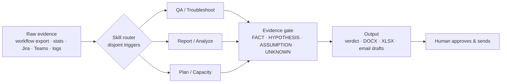

<div align="center">


**INDEPENDENT ENGINEERING PORTFOLIO · CRM OPS AI SKILLS**

[GitHub Profile](https://github.com/sghatge) · [Portfolio](https://sghatge.github.io/adobe-campaign-v8-governance/)

</div>

---

# CRM Ops AI Skills

**An evidence-first AI operating layer for multi-market CRM & Marketing Operations teams.**

Ten Claude Agent Skills that codify how a senior Marketing Ops team runs Adobe Campaign Classic v8 and Stensul operations: pre-launch QA, troubleshooting, performance reporting, lifecycle tracking, postmortems and capacity cases — with one non-negotiable rule:

> **The AI never invents a campaign ID, date, count, owner or approval.** Every finding is labelled FACT / HYPOTHESIS / ASSUMPTION / UNKNOWN and traced to its source. Missing evidence is reported as missing.

## ⏱ ~16 hours back per campaign manager, every week (estimated)

| Task | Manual | With skills | Volume / week | Saved / week |
|---|---:|---:|---:|---:|
| Pre-launch QA (per campaign) | 90 min | 30 min | 6 | **6.0 h** |
| Incident troubleshooting | 120 min | 45 min | 2 | **2.5 h** |
| Performance report + stakeholder emails | 120 min | 20 min | 3 | **5.0 h** |
| Thread triage / who-owes-what | 45 min | 10 min | 5 | **2.9 h** |
| **Weekly total** | | | | **≈ 16 h** |
| Postmortem (monthly) | 6 h | 2 h | 1 / month | 4 h / month |
| Workload & capacity case (quarterly) | 3 days | 4 h | 1 / quarter | 20 h / quarter |

**≈ 80 hours a month — about half an FTE — returned to execution.**
These are estimates for a manager running 6 campaigns a week. Replace the volumes and timings with your own measurements during the pilot (see [docs/INSTALL.md](docs/INSTALL.md)); the arithmetic is in this table so anyone can check it.

## 🔁 How it works



1. **Paste or attach evidence** — no special format needed.
2. **The right skill fires** on its own, based on what you pasted.
3. **Every claim passes the evidence gate** — sourced or flagged as missing.
4. **You get a deliverable**, not a chat: verdict table, report, workbook or draft.
5. **A human decides and sends.** Nothing goes out automatically.

## 🚀 Implement it in 30 minutes

| Step | Time | Do this |
|---|---:|---|
| 1 | 5 min | Clone the repo or download the zip |
| 2 | 10 min | Fill the `Market Context` block in each skill (markets, ID pattern, escalation path, benchmarks) |
| 3 | 5 min | Upload the skill folders (Claude.ai) or copy to `~/.claude/skills/` (Claude Code) |
| 4 | 10 min | Run the three demo prompts in [docs/SHOWCASE.md](docs/SHOWCASE.md) on a real past campaign |
| Then | 2 weeks | Pilot QA in parallel with your checklist; log minutes saved and issues caught |

See it in action: **[docs/SHOWCASE.md](docs/SHOWCASE.md)** — real prompts with the output you get back.

---

## Why this exists

Generic AI assistants are fluent but unsafe for campaign operations: they fill gaps with plausible numbers, merge campaigns, and guess timelines. In CRM ops one wrong recipient count or invented approval is an incident.

These skills turn tribal knowledge into a repeatable, governed pipeline:

| Problem | What the skills enforce |
|---|---|
| Inconsistent pre-launch QA across markets | One 7-stage review with a severity scale and GO / NO-GO verdict |
| Same incidents rediscovered by each engineer | A known-issues database with root cause → fix → prevention |
| Reports that take hours to format | Raw Adobe Campaign stats → DOCX report + stakeholder email drafts |
| Postmortems built on hearsay | 2+ independent sources for any root cause; coverage log of what was *not* searched |
| "We need more people" with no numbers | A 10-sheet capacity model with systemic root causes |

## The skills

| Skill | Use it when you… | Output |
|---|---|---|
| `campaign-manager` | need go/no-go, lifecycle status, risk scans, audience validation, chasers | Classified findings + labelled recommendations |
| `acc-v8-campaign-qa` | review an ACC v8 build before launch, or diagnose a bad send | Verdict + findings table (stage, severity, evidence, fix, owner) |
| `crm-ops-troubleshooter` | hit an Adobe Campaign error, SFTP/voucher issue, typology or data-pipeline problem | Layer-isolated diagnosis from a known-issues database |
| `stensul-troubleshooter` | run Stensul builds, provisioning, or a migration off a legacy builder | Fixes, archival process, UAT mapping, comms templates |
| `campaign-performance-report` | paste raw delivery/open/click stats | DOCX report + 2 email draft variants |
| `chat-thread-analyzer` | paste a Teams/Jira/email thread | Timeline, accountability map, blockers, draft reply |
| `crm-evidence-analyst` | need an evidence-only postmortem or Jira summary | FACT/HYPOTHESIS/ASSUMPTION/UNKNOWN findings |
| `crm-evidence-report-pro` | need a leadership-grade audit with source-access labels | Coverage log, evidence matrix, action-titled sections |
| `workload-assessment-builder` | need to quantify demand vs capacity | 10-sheet Excel capacity model + leadership brief |
| `crm-explainer-video` | need a 1–2 min stakeholder explainer | HyperFrames MP4 storyboard + render |

## Design principles

1. **Evidence before fluency.** Facts are sourced; recommendations are labelled; the two never mix.
2. **Disjoint triggers.** Each skill keys off a different input shape and carries an explicit `DO NOT fire when…` block and a `PRECEDENCE` line, so the right skill fires.
3. **Market-agnostic core, editable context.** Every skill has a `Market Context` block — fill in your markets, owners and conventions; the method stays the same.
4. **Root cause before recommendation.** Every diagnostic skill ends symptom → cause → fix → prevention.
5. **Automation bias.** When a manual check fails and could recur, the skill recommends an alert, rule or pre-send gate.
6. **Drafts only.** No skill sends email or messages on anyone's behalf.

## Install

### Claude.ai / Claude desktop
1. Zip a skill folder (e.g. `skills/acc-v8-campaign-qa/`).
2. Settings → Capabilities → Skills → **Upload skill**.
3. Repeat for each skill your team needs. Org admins can provision them for the whole team.

### Claude Code
```bash
git clone https://github.com/<your-username>/crm-ops-ai-skills.git
mkdir -p ~/.claude/skills
cp -r crm-ops-ai-skills/skills/* ~/.claude/skills/
```
Or per project: copy into `.claude/skills/` in the repo.

### First-run setup
Open each `SKILL.md` and fill in the **Market Context** block (markets, campaign ID pattern, escalation path, benchmarks). Leave anything unknown as `TBC` — the skills will ask rather than guess.

## Example prompts

```
Review this ACC v8 workflow export and proof screenshots for Market A — go or no-go?
Here are the delivery stats for W43 onboarding email. Build the report and two email drafts.
Proof generation hangs on send — here's the workflow log.
Paste: 40-message Teams thread. Who owes what, and what's blocking the send?
Build a workload assessment from this Jira export for Q3.
```

## Repository layout
```
skills/
  <skill-name>/SKILL.md
docs/
  INSTALL.md
  SHOWCASE.md
CONTRIBUTING.md
LICENSE
```

## Contributing
Add a known issue, a benchmark range or a new play via pull request. See [CONTRIBUTING.md](CONTRIBUTING.md). Never commit real customer data, recipient lists, internal paths or colleague names.

## Author
Built by **Sangram Ghatge** — Marketing Ops & CRM Technology lead (Adobe Campaign Classic v8, Stensul, Salesforce, AI operating models).
[LinkedIn](https://www.linkedin.com/in/sangram-g-2369705b) · [GitHub](https://github.com/sghatge)

## License
MIT — see [LICENSE](LICENSE).
